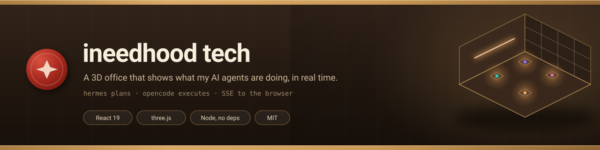
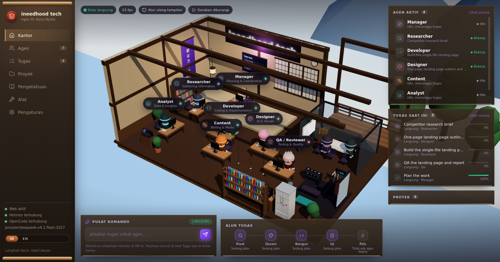
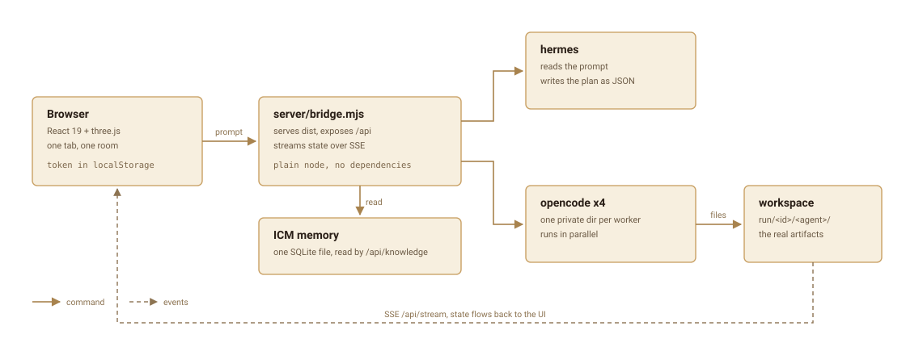
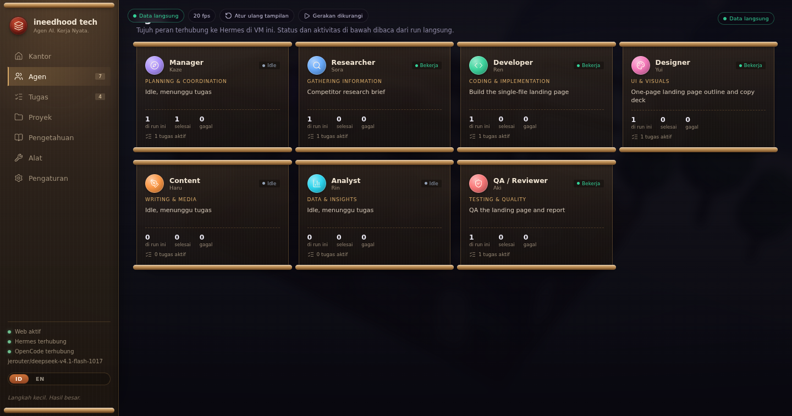

<p align="center">
  
</p>

<p align="center">
  <b>A 3D office that shows what my AI agents are doing, in real time.</b><br>
  One browser tab, one machine, no accounts for other people.
</p>

<p align="center">
  <a href="LICENSE"></a>
  
  
  
  
</p>

<p align="center">
  
</p>

<p align="center">
  <sub>A real run, not a mockup. <code>hermes</code> split the prompt into four tasks and four
  <code>opencode</code> workers are executing them in parallel. The name tags, the progress
  bars and the task list all come from the same <code>/api/state</code> payload.</sub>
</p>

## Why this exists

I run several coding agents on one machine and kept losing track of what was actually
happening. Logs scroll, terminals overlap, and "it said done" is not the same as "it
produced something". So the state of every agent is drawn as a room I can glance at:
desks light up while a worker runs, the tag above each chibi shows its current task, and
finished work shows up as a file you can open.

The room is a means to an end. The point is that **nothing on screen is invented**: if a
worker fails, the card says failed; if the planner dies, the run fails; if an artifact
does not exist, the files panel is empty instead of showing a placeholder.

## What it does

- **A desk per agent.** Seven chibis, one room, an isometric camera you can nudge.
- **Live, not polled.** `/api/stream` pushes every state change over SSE. The scene reads
  the same tasks the panels do, so the floor and the sidebar can never disagree.
- **Real artifacts.** Every worker writes into its own directory and the UI links to the
  actual files. No "done" without a file.
- **Honest runtime probe.** The sidebar asks both binaries for `--version`, retries once,
  and tells `connected`, `not found` and `probe failed` apart.
- **Two languages**, Indonesian and English, including status chips and row tags.
- **Two front doors.** The browser, and Telegram through the Hermes messaging gateway.
  Both talk to the same ICM memory, so context carries across devices.
- **A guest session** that is read only, enforced by the server, not by hiding buttons.
- **No database, no framework on the server.** `server/bridge.mjs` is plain Node with
  zero dependencies.

## How a run works

<p align="center">
  
</p>

1. The browser sends a prompt to `POST /api/task` and gets `202` back immediately.
2. The bridge asks `hermes` to turn the prompt into a plan: which agents, what each one
   should do, in what order.
3. It spawns one `opencode` process per task, each in a **private directory**, so two
   workers can never fight over the same file.
4. Workers write real files into `workspace/<runId>/<agent>/`.
5. Every step is pushed to the UI over SSE. The scene, the task list and the project view
   all read from that one feed.

If `hermes` or `opencode` is missing, the run fails at planning instead of pretending to
work, and the runtime panel says which binary is missing.

## Command it from Telegram

The same agent brain answers on Telegram through the Hermes messaging gateway. That
matters because there is **one** ICM memory database, so a conversation started in a
terminal, in a Telegram chat, or by a run in this office all read and write the same
context. You do not re-explain the project every time you change device.

```bash
hermes gateway setup     # pick Telegram, paste the bot token
hermes gateway start     # systemd or launchd service, survives logout
hermes gateway status
```

- Credentials live in `~/.hermes/.env` as `TELEGRAM_BOT_TOKEN`, next to
  `TELEGRAM_ALLOWED_USERS` and `TELEGRAM_HOME_CHANNEL`. None of that belongs in this
  repo, and the bridge never reads it.
- The gateway keeps `icm serve` as a child process, which is what makes the shared
  context real rather than aspirational: the terminal, the room and the phone are all
  talking to the same store.
- Honest limit: the 3D room draws the runs **the bridge starts**. A Telegram
  conversation shares the memory but does not create a card in the scene, because the
  bridge never sees it. If you want a job to appear in the room, start it through
  `POST /api/task`.

## Run it

```bash
npm ci
npm run build            # tsc -b && vite build -> dist/
node server/set-pass.mjs <your-password>
node server/bridge.mjs   # serves dist + API on :8080
```

Open <http://localhost:8080> and enter the password. The hash is written to
`data/auth.json` (chmod 600).

If `data/auth.json` does not exist the bridge runs with no password at all, which is only
acceptable on localhost.

## Requirements

- Node 22 (tested on 22.23.3). Nothing else is required to run the UI.
- Optional, only for real runs: a `hermes` binary and an `opencode` binary, plus a model
  endpoint that `opencode` can reach. Point at them with `HERMES_BIN`, `OPENCODE_BIN`,
  `OC_MODEL`, `OC_GATEWAY`.
- Optional, only for the Knowledge view: `python3` and an ICM SQLite database.

Without the agent binaries the UI still runs, the scene still renders, and the runtime
panel honestly says `Hermes not found` or `OpenCode not found`.

## Views

<p align="center">
  
</p>

Seven views, all reading the same state: **Office** (the 3D room), **Agents**, **Tasks**,
**Projects**, **Knowledge**, **Tools**, **Settings**. Every card is built from the same
wood and paper vocabulary as the room, so the dashboard does not look like a different
product.

## Guest mode

There are two kinds of session. The owner session comes from the password and may start
runs. A guest session needs no password and may only read.

- On the gate, **Lihat saja / View only** issues a guest session with one click.
- `https://your-host/?guest=1` enters guest mode directly, so a view-only link can be
  shared without telling anyone the password.
- The bridge enforces this, not the UI. A guest token gets
  `403 {"error":"guest mode is read-only"}` on `POST /api/task`, `/api/image`,
  `/api/projects`, `/api/projects/delete`, and every other mutating route. The role lives
  in the server session map, so editing localStorage does not upgrade it.
- In guest mode the command center is disabled, the project form and the run and delete
  buttons are hidden, and a badge in the sidebar says why.
- An existing owner session is never downgraded by opening `?guest=1`.

## What is live and what is not

- Live: agent status, current task per desk, task list, progress, run state. All of it
  comes from `/api/state` and the `/api/stream` SSE feed.
- Live: the runtime panel in the sidebar. It probes both binaries with `--version`,
  retries once, and distinguishes `connected`, `not found`, and `probe failed`. It never
  reports a failed probe as disconnected.
- Demo: when the bridge is unreachable the scene falls back to the fixtures in
  `src/data/demo.ts` and says so in the header chip.
- `src/scene/OfficeScene.ts` turns the demo loop off while `liveMode` is on.

## Stack

- React 19 + TypeScript + Vite 8 for the UI.
- three.js for the scene. No physics, one shadow-casting light, DOM labels projected from
  3D positions.
- `server/bridge.mjs`: plain Node, no dependencies. It serves the build, exposes the API,
  streams run events over SSE, and drives the agents.
- Icons are generated from [Lucide](https://lucide.dev) (ISC) into
  `src/components/icons.ts` as inline SVG, so there is no icon package at runtime.

## Layout

```
src/
  App.tsx           page shell, live event wiring, panels
  live.ts           EventSource client with reconnect and heartbeat
  api.ts            fetch wrapper, token handling, password gate
  components/       sidebar, panels, views, generated icons
  scene/            three.js scene, room builder, textures, chibis
  data/demo.ts      idle-scene fixtures
server/
  bridge.mjs        static build + API + SSE + agent runner
  set-pass.mjs      write the password hash
  knowledge.py      read the ICM memory database for the Knowledge view
public/             favicon and static bits
docs/               the images used in this README
scripts/legacy/     the old python http.server start and stop scripts
```

## API

Every `/api` route except `/api/auth` and `/api/guest` needs the `x-0xyas-token` header.
The SSE route also accepts `?token=`. `/health` and the static build are open, which is
why the browser can load the page and then ask for the password.

Get an owner token from `POST /api/auth` with `{"password":"..."}`, or a read only token
from `POST /api/guest` with no body.

| Route | Method | Purpose |
| --- | --- | --- |
| `/health` | GET | liveness, no auth |
| `/api/auth` | POST | exchange the password for an owner token |
| `/api/guest` | POST | read only token, no password |
| `/api/whoami` | GET | role of the current token |
| `/api/state` | GET | current run, tasks, agents |
| `/api/stream` | GET | SSE feed of state changes |
| `/api/task` | POST | submit a prompt, returns `202` |
| `/api/image` | POST | generate an image through the gateway |
| `/api/runtime` | GET | bridge, hermes, opencode, model, memory |
| `/api/projects` | GET, POST | list projects / create one |
| `/api/projects/detail` | GET | one project with its runs |
| `/api/projects/delete` | POST | delete a project |
| `/api/files` | GET | artifacts produced by a run |
| `/api/file` | GET | one artifact |
| `/api/skills` | GET | skills found in `SKILLS_DIR` |
| `/api/skills/match` | GET | best matching skills for a prompt |
| `/api/knowledge` | GET | rows from the ICM database |

## Env

Every path defaults to somewhere inside the repo, so a clone runs anywhere. Set these only
when your layout differs.

| Variable | Default | Purpose |
| --- | --- | --- |
| `PORT` | `8080` | HTTP port |
| `DATA_DIR` | `<repo>/data` | `auth.json`, `projects.json` |
| `WORKSPACE_DIR` | `<repo>/runs` | where runs and artifacts are written |
| `STAGING_DIR` | `<repo>/staging` | allowed root for an explicit `workdir` |
| `DIST_DIR` | `<repo>/dist` | the built UI |
| `SKILLS_DIR` | `<repo>/skills` | skills copied into worker runs |
| `HOME_DIR` | `$HOME` | base for the default ICM path |
| `ICM_DB` | `$HOME/.local/share/icm/memories.db` | Knowledge view source |
| `HERMES_BIN` | `/data/home/.local/bin/hermes` | planner binary |
| `OPENCODE_BIN` | `/data/home/.opencode/bin/opencode` | worker binary |
| `OC_MODEL` | `jerouter/deepseek-v4.1-flash-1017` | model passed to opencode |
| `OC_GATEWAY` | `https://je.jerouter.web.id/v1` | model endpoint |
| `PLANNER_TIMEOUT_MS` | `420000` | manager timeout |
| `WORKER_TIMEOUT_MS` | `900000` | worker timeout |

## Notes

- `dist/` is generated, not committed. Run `npm run build` after cloning.
- The bridge keeps sessions in memory, so restarting it logs every browser out.
- The bridge has no runtime dependencies. `npm ci` installs build tooling only.
- It is a single-user tool. The hosted copy exposes a read-only guest view, so nobody
  else can start a run.

## License

MIT, see [LICENSE](LICENSE).
